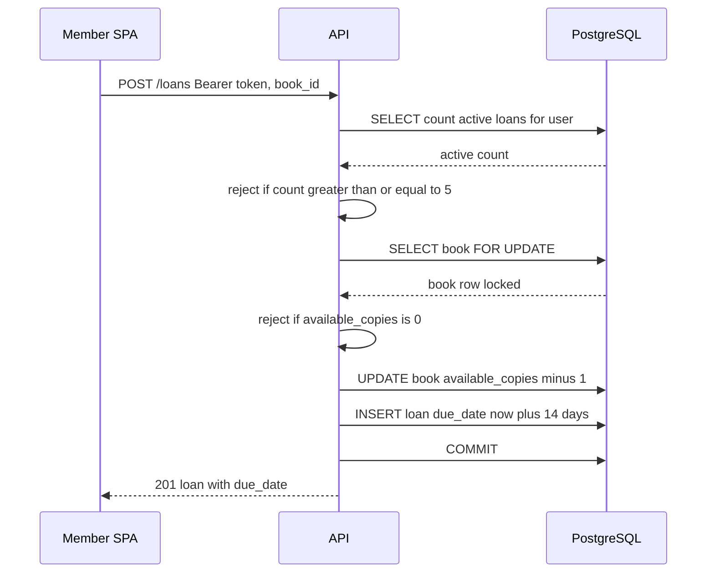
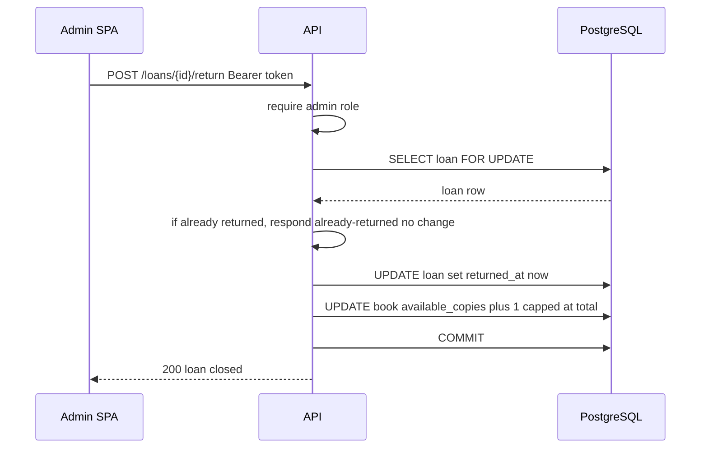
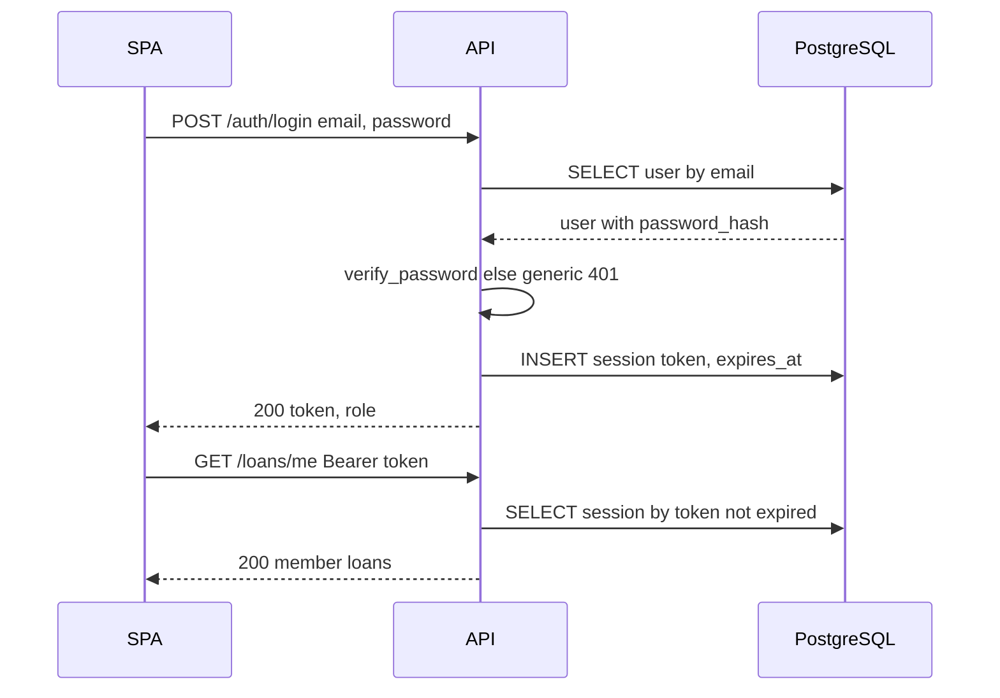
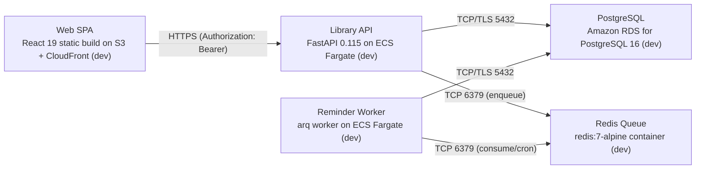

# Architecture

> Maintained by QuorQ AI SDLC. Text between `sdlc:auto` markers is regenerated; anything outside them is yours and is kept.

<!-- sdlc:auto:start narrative -->
## Overview

### ARCH-001 · approved · source: architecture:summary

Book Lending is architected as a lightweight public library web app: React 19 SPA, FastAPI 0.115 API, PostgreSQL 16 database, all on AWS, version 4 of the architecture, approved.

Key decisions: members self-register and sign in; browse/search catalog by title and author with live availability; borrow in one action with a fixed 14-day due date, capped at 5 active loans, blocked when copies are zero; member dashboard shows own loans with overdue flags. Admins manage the catalog (add/edit/delete) and mark loans returned, which restores copy counts safely; admins see an overview of all active and overdue loans. Auth uses server-side opaque-token sessions sent as Authorization: Bearer headers specifically because the SPA and API are served from separate origins. An approved Redis queue drives a scheduled background job computing due-soon/overdue status; email reminders are explicitly out of scope -- overdue handling is on-screen flagging only.

### ARCH-FE · approved · source: architecture:components:frontend

Web SPA (React 19) is the responsive, mobile-friendly frontend covering registration, sign-in, catalog browse/search, borrowing, the member dashboard, and admin catalog/loan management.

Stores the opaque session token client-side and sends it as an Authorization: Bearer header on every API call. Deployed as a static build on S3 + CloudFront, served from its own origin, separate from the API origin.

### ARCH-API · approved · source: architecture:components:api

Library API (FastAPI 0.115) is the stateless REST backend enforcing all business rules.

Enforces: hashed-password auth with server-side sessions; member vs admin authorization; catalog CRUD; 14-day borrowing with a 5-loan cap and zero-copy block; admin-only returns; member and admin dashboards. Does not enqueue user-facing work beyond the scheduled reminder/overdue job. Deployed on ECS Fargate running Python 3.12 / Uvicorn, on its own origin.

### ARCH-WORKER · approved · source: architecture:components:worker

Background worker runs a recurring scheduled job off the Redis queue to compute due-soon and overdue loan status used by dashboards.

Component name field in the input was left blank (listed as "()"); technology is an arq worker process on Python 3.12. Email delivery is explicitly out of scope, so the job's only output is refreshed overdue visibility for the member and admin dashboards. Deployed as the "Reminder Worker" on ECS Fargate.

### ARCH-DB · approved · source: architecture:components:db

PostgreSQL 16 is the durable store for Users, Books, Loans, and session tokens, with row-level locking to prevent overselling copies.

Enforces relational integrity between Users/Books/Loans. Uses row-level locking (SELECT ... FOR UPDATE per the technology decision) so concurrent borrow requests cannot drive available copies below zero -- satisfies NFR-006. Deployed as Amazon RDS for PostgreSQL 16 in dev.

**Related:** NFR-006

### ARCH-QUEUE · approved · source: architecture:components:queue

Redis 7 queue schedules and runs the recurring reminder/overdue-check job without blocking member-facing requests.

Backing technology is redis:7-alpine. Purpose is strictly to decouple the scheduled due-soon/overdue computation from the request path of the API; it is not used for any other user-facing workflow.

### ARCH-CP-BORROW · approved · source: architecture:critical_paths:borrow

Borrowing a book is designed to be safe under concurrency so two members cannot take the last copy.

Step 1: Member borrows an available book via POST /loans. Step 2: API validates the session. Step 3: API checks the member is below the 5-loan cap. Step 4: API locks the book row. Step 5: API verifies available copies > 0. Step 6: API decrements the available-copy count. Step 7: API creates a loan record with a 14-day due date. Step 8: API commits the transaction atomically, guaranteeing no two concurrent borrows can oversell the last copy.

**Related:** US-005, US-006

### ARCH-CP-RETURN · approved · source: architecture:critical_paths:return

Marking a loan returned is an admin-only action that safely restores copy counts.

Step 1: Admin closes an active loan via POST /loans/{id}/return. Step 2: API verifies the caller has the admin role. Step 3: API ensures the loan is not already returned (idempotent on already-returned loans). Step 4: API sets returned_at on the loan. Step 5: API increments the book's available_copies without exceeding total_copies.

**Related:** US-008

### ARCH-CP-SIGNIN · approved · source: architecture:critical_paths:signin

Sign-in uses server-side opaque session tokens rather than client-held JWTs, chosen because the SPA and API run on separate origins.

Step 1: Registered user submits email and password via POST /auth/login. Step 2: API verifies the bcrypt password hash. Step 3: API creates a server-side session row with an expiry. Step 4: API returns an opaque token in the response body (plus account role). Step 5: SPA stores the token and sends it as an Authorization: Bearer header on subsequent calls. Step 6: Sign-out (POST /auth/logout) revokes the session server-side.

**Related:** US-002

### ARCH-DATA-MODEL · approved · source: architecture:entities

Data model has four tables: users, books, loans, and sessions.

users: id, email, password_hash, role, created_at. books: id, title, author, total_copies, available_copies, created_at. loans: id, user_id, book_id, borrowed_at, due_date, returned_at. sessions: token, user_id, created_at, expires_at. Note/conflict: the original project description specifies "three tables: Users, Books and Loans," but the approved v4 architecture adds a fourth table, sessions, to persist server-side opaque session tokens -- both versions are recorded here since they differ.

**Related:** US-001, US-002

### ARCH-EP-AUTH · approved · source: architecture:endpoints:auth

Three auth endpoints handle self-registration, login, and logout.

POST /auth/register: self-registers a member account; rejects duplicate email, invalid email format, or blank password; always creates role=member. POST /auth/login: signs in with email and password; returns an opaque session token in the body plus the account role. POST /auth/logout: revokes the current session token server-side.

**Related:** US-001, US-002

### ARCH-EP-BOOKS · approved · source: architecture:endpoints:books

Four book endpoints cover browsing/search and admin catalog management.

GET /books: browse or search the catalog; optional q matches partial title or author; returns availability per book. POST /books (admin): adds a book, setting total and available copies to the given count (>=1); rejects blank title/author or negative copies. PUT /books/{id} (admin): edits title, author, and total copies; available copies is adjusted to never go below zero or above total minus copies currently on loan. DELETE /books/{id} (admin): deletes a book only if it has no active loans; blocked with a message otherwise.

**Related:** US-003, US-004

### ARCH-EP-LOANS · approved · source: architecture:endpoints:loans

Four loan endpoints cover borrowing, returns, and the member/admin dashboards.

POST /loans: member borrows a book in one action; enforces the 5-loan cap and zero-copy block, decrements availability, sets a 14-day due date, no fee charged. POST /loans/{id}/return (admin): marks a loan returned, closes the loan, increments available copies; idempotent if already returned. GET /loans/me: member dashboard listing the signed-in member's active loans with book title, due date, and overdue flag; empty list when none. GET /loans (admin): overview of every active loan across members with member, book title, due date, and overdue flag.

**Related:** US-005, US-006, US-007, US-008

### ARCH-DEPLOY · approved · source: architecture:deployment_nodes

Five deployment nodes on AWS host the SPA, API, worker, database, and queue, each on dev infrastructure.

Web SPA: React 19 static build on S3 + CloudFront, static assets, own origin. Library API: FastAPI 0.115 on ECS Fargate, Python 3.12 / Uvicorn, own origin. Reminder Worker: arq worker on ECS Fargate, Python 3.12 arq process. PostgreSQL: Amazon RDS for PostgreSQL 16. Redis Queue: redis:7-alpine container, Redis 7. All nodes are currently labeled (dev) environment.

**Related:** NFR-008

### ARCH-TECH-FRONTEND · approved · source: architecture:technology_decisions:frontend

React 19 is the approved frontend stack over Vue and SvelteKit alternatives.

Rationale given: delivers the two responsive views (member browse/borrow/dashboard and admin catalog/loans) as a single-page app that stores the bearer token and calls the API across origins.

### ARCH-TECH-BACKEND · approved · source: architecture:technology_decisions:backend

FastAPI 0.115 is the approved backend stack over Django REST Framework and Flask alternatives.

Rationale given: expresses the server-side rules (5-loan cap, zero-copy block, 14-day due date, admin-only returns) and auto-generates the OpenAPI docs required by US-018.

**Related:** US-018

### ARCH-TECH-DB · approved · source: architecture:technology_decisions:database

PostgreSQL 16 is the approved database stack over MySQL and SQLite alternatives.

Rationale given: enforces the Users/Books/Loans relationships and uses SELECT ... FOR UPDATE row locking so concurrent borrows cannot take the last copy -- directly satisfies NFR-006.

**Related:** NFR-006

### ARCH-TECH-CLOUD · approved · source: architecture:technology_decisions:cloud

AWS is the approved cloud platform over GCP and Azure alternatives.

Rationale given: RDS, Fargate, and CloudFront give always-on hosting for the SPA, API, worker, and database in one place, satisfying NFR-008, and scale from launch to thousands of users.

**Related:** NFR-008
<!-- sdlc:auto:end narrative -->

<!-- sdlc:auto:start building-blocks -->
## Building Block View

| ID | Name | Technology | Responsibility | Depends on |
|---|---|---|---|---|
| frontend | Web SPA | React 19 | Responsive mobile-friendly UI for registration, sign-in, catalog browse/search, borrowing, member dashboard, and admin catalog/loan management. Stores the opaque session token and sends it as Authorization: Bearer on every API call. | api |
| api | Library API | FastAPI 0.115 | Stateless REST API enforcing all business rules: hashed-password auth with server-side sessions, member vs admin authorization, catalog CRUD, 14-day borrowing with 5-loan cap and zero-copy block, admin-only returns, and dashboards. Enqueues no user-facing work beyond the scheduled reminder job. | db, queue |
| worker | — | — | Background worker that runs a recurring scheduled job off the Redis queue to compute due-soon and overdue loans. Email delivery is out of scope, so the job only refreshes overdue visibility used by the dashboards. | db, queue |
| db | PostgreSQL Database | PostgreSQL 16 | Durable store for Users, Books and Loans (plus session tokens). Enforces relationships and uses row-level locking so concurrent borrows cannot drive available copies below zero. | — |
| queue | Redis Queue | Redis 7 (redis:7-alpine) | Redis-backed queue that schedules and runs the recurring reminder/overdue-check job so it never blocks member requests. | — |

```mermaid
graph TD
  c_frontend["Web SPA"]
  c_api["Library API"]
  c_worker[""]
  c_db["PostgreSQL Database"]
  c_queue["Redis Queue"]
  c_frontend --> c_api
  c_api --> c_db
  c_api --> c_queue
  c_worker --> c_db
  c_worker --> c_queue
```
<!-- sdlc:auto:end building-blocks -->

<!-- sdlc:auto:start runtime -->
## Runtime View

### Borrow a book safely under concurrency

A member borrows an available book. The API validates the session, checks the member is below the 5-loan cap, locks the book row, verifies available copies > 0, decrements the count, creates a loan with a 14-day due date, and commits atomically so two members cannot take the last copy.

- **Components:** frontend, api, db
- **Modules:** routers/loans, services/borrowing, repositories/books, repositories/loans
- **Key functions:** borrow_book(user_id, book_id), count_active_loans(user_id), lock_book_for_update(book_id), decrement_available(book_id), create_loan(user_id, book_id, due_date)



### Admin marks a loan returned

An admin closes an active loan. The API verifies admin role, ensures the loan is not already returned, sets returned_at, and increments the book's available copies without exceeding total copies.

- **Components:** frontend, api, db
- **Modules:** routers/loans, services/returns, repositories/loans, repositories/books
- **Key functions:** return_loan(loan_id, admin_user), lock_loan_for_update(loan_id), increment_available(book_id)



### Sign in with opaque session token

A registered user signs in; the API verifies the bcrypt password hash, creates a server-side session row with an expiry, and returns an opaque token in the response body. The SPA stores it and sends it as a bearer token; sign-out revokes the session.

- **Components:** frontend, api, db
- **Modules:** routers/auth, services/auth, repositories/users, repositories/sessions
- **Key functions:** login(email, password), verify_password(password, hash), create_session(user_id), resolve_session(token), revoke_session(token)


<!-- sdlc:auto:end runtime -->

<!-- sdlc:auto:start deployment-view -->
## Deployment View

| Name | Service | Runtime | Scaling | Environment |
|---|---|---|---|---|
| Web SPA | React 19 static build on S3 + CloudFront (dev) | Static assets, served from its own origin | CDN edge | dev |
| Library API | FastAPI 0.115 on ECS Fargate (dev) | Python 3.12 / Uvicorn, its own origin | 1 task in dev, horizontal later | dev |
| Reminder Worker | arq worker on ECS Fargate (dev) | Python 3.12 arq process | 1 task | dev |
| PostgreSQL | Amazon RDS for PostgreSQL 16 (dev) | PostgreSQL 16 | single instance in dev | dev |
| Redis Queue | redis:7-alpine container (dev) | Redis 7 | single node | dev |

| Source | Target | Protocol |
|---|---|---|
| Web SPA | Library API | HTTPS (Authorization: Bearer) |
| Library API | PostgreSQL | TCP/TLS 5432 |
| Library API | Redis Queue | TCP 6379 (enqueue) |
| Reminder Worker | Redis Queue | TCP 6379 (consume/cron) |
| Reminder Worker | PostgreSQL | TCP/TLS 5432 |


<!-- sdlc:auto:end deployment-view -->

<!-- sdlc:auto:start decisions -->
## Architecture Decisions

| Layer | Choice | ADR |
|---|---|---|
| Frontend | React 19 | [ADR-0001](adr/frontend.md) |
| Backend | FastAPI 0.115 | [ADR-0002](adr/backend.md) |
| Database | PostgreSQL 16 | [ADR-0003](adr/database.md) |
| Cloud | AWS | [ADR-0004](adr/cloud.md) |
<!-- sdlc:auto:end decisions -->

<!-- sdlc:auto:start links -->
## Related Documents

- [Data Model](data-model.md)
- [API Specification](api/openapi.yaml)
- [Architecture Decision Records](adr/README.md)
<!-- sdlc:auto:end links -->
