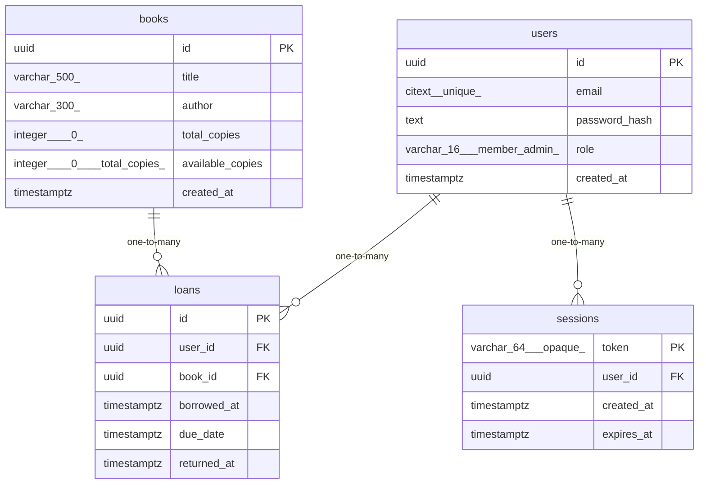

# Data Model

<!-- sdlc:auto:start entities -->
### users

| Field | Type | PK | FK | Nullable |
|---|---|---|---|---|
| id | uuid | True | — | False |
| email | citext (unique) | False | — | False |
| password_hash | text | False | — | False |
| role | varchar(16) (member\|admin) | False | — | False |
| created_at | timestamptz | False | — | False |

### books

| Field | Type | PK | FK | Nullable |
|---|---|---|---|---|
| id | uuid | True | — | False |
| title | varchar(500) | False | — | False |
| author | varchar(300) | False | — | False |
| total_copies | integer (>=0) | False | — | False |
| available_copies | integer (>=0, <=total_copies) | False | — | False |
| created_at | timestamptz | False | — | False |

### loans

| Field | Type | PK | FK | Nullable |
|---|---|---|---|---|
| id | uuid | True | — | False |
| user_id | uuid | False | users.id | False |
| book_id | uuid | False | books.id | False |
| borrowed_at | timestamptz | False | — | False |
| due_date | timestamptz | False | — | False |
| returned_at | timestamptz | False | — | True |

### sessions

| Field | Type | PK | FK | Nullable |
|---|---|---|---|---|
| token | varchar(64) (opaque) | True | — | False |
| user_id | uuid | False | users.id | False |
| created_at | timestamptz | False | — | False |
| expires_at | timestamptz | False | — | False |
<!-- sdlc:auto:end entities -->

<!-- sdlc:auto:start relationships -->
| Source | Target | Type |
|---|---|---|
| users | loans | one-to-many |
| books | loans | one-to-many |
| users | sessions | one-to-many |
<!-- sdlc:auto:end relationships -->

<!-- sdlc:auto:start er-diagram -->

<!-- sdlc:auto:end er-diagram -->
