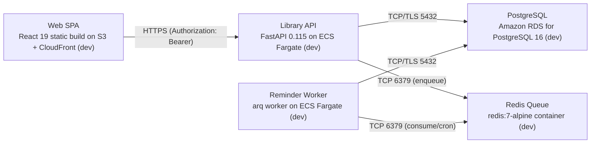

# Deployment Guide

> Maintained by QuorQ AI SDLC. Text between `sdlc:auto` markers is regenerated; anything outside them is yours and is kept.

<!-- sdlc:auto:start how-it-deploys -->
Pushes to `main` run `.github/workflows/deploy.yml`, which builds the API image (if there is a backend) and deploys the SPA to AWS Amplify. Commits touching only `docs/sdlc/**` don't deploy. Deployments can also be started from the platform's Deployment tab.
<!-- sdlc:auto:end how-it-deploys -->

<!-- sdlc:auto:start environments -->
| Name | Service | Runtime | Scaling | Environment |
|---|---|---|---|---|
| Web SPA | React 19 static build on S3 + CloudFront (dev) | Static assets, served from its own origin | CDN edge | dev |
| Library API | FastAPI 0.115 on ECS Fargate (dev) | Python 3.12 / Uvicorn, its own origin | 1 task in dev, horizontal later | dev |
| Reminder Worker | arq worker on ECS Fargate (dev) | Python 3.12 arq process | 1 task | dev |
| PostgreSQL | Amazon RDS for PostgreSQL 16 (dev) | PostgreSQL 16 | single instance in dev | dev |
| Redis Queue | redis:7-alpine container (dev) | Redis 7 | single node | dev |
<!-- sdlc:auto:end environments -->

<!-- sdlc:auto:start live -->
_Not deployed yet._
<!-- sdlc:auto:end live -->

<!-- sdlc:auto:start topology -->

<!-- sdlc:auto:end topology -->
